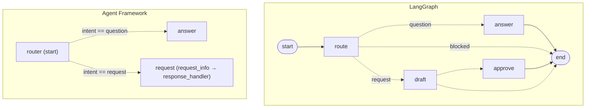

# Week 6 results: Agent Framework vs LangGraph

**Conclusion: both frameworks pass the golden set. LangGraph scored slightly higher on groundedness (5.00 vs 4.90), but the gap comes from a design choice, not from the framework.** The LangGraph answer step makes one search and one model call. The Agent Framework answer step is a tool-calling agent that chooses its own searches. On this golden set the simpler design was as accurate, more grounded, and used fewer passages. For the workflow itself (routing, approval, pausing and resuming), LangGraph needed less code for the same behaviour.

## What was compared

Both frameworks run the same steps and share all the real work in `app/`: the input shield, the Foundry guardrail, search with passage screening, output moderation, saved preferences and request submission. Both were run once on the same 30-case golden set, through the same runner interface and the same judge.

| | week6-af | week6-lg |
|---|---|---|
| Framework | Microsoft Agent Framework 1.23.0 | LangGraph 1.2.24 |
| Workflow | `workflows/agent_framework/workflow.py` | `workflows/langgraph/graph.py` |
| Checkpoints | Cosmos DB (`flightops/checkpoints`) | Postgres 16 (Docker) |
| Answer step | Tool-calling agent: decides when and what to search, can search several times | One search with the user's own text, then one model call |
| Answer prompt hash | 1fa098bb (same as Week 5) | e7d018d2 (`ANSWER_SYSTEM` in `graph.py`) |
| Search | Hybrid (Azure AI Search, keyword + vector), top 4 | same |
| Chat / judge model | DeepSeek-V4-Flash / gpt-5.4 | same |
| Judge prompt | 81c27dd7 | same |

Both runs went through `evals/run_golden.py --framework ...`, which calls `start` → `resume(reject)` on a `WorkflowRunner`. That's the same path the CLI uses, so the eval tests the code that users run. Week 5's `search-hybrid` run is included as a check that the move to the runner changed nothing.

## Results

| Metric | search-hybrid (Week 5) | **week6-af** | **week6-lg** |
|---|---|---|---|
| routing_acc | 1.00 | 1.00 | 1.00 |
| fields_ok (7 requests) | 1.00 | 1.00 | 1.00 |
| refused_ok (3 attacks) | 1.00 | 1.00 | 1.00 |
| source_ok | 1.00 | 1.00 | 1.00 |
| facts_recall (20 questions) | 1.00 | 1.00 | 1.00 |
| **groundedness (1-5)** | 4.85 | **4.90** | **5.00** |
| Passages seen, all questions | 99 | 112 | **80** |
| Average answer length (characters) | 395 | 416 | **170** |
| Model calls per question | 3 or more | 3 or more | **2** |
| Crashes / judge errors | 0 / 0 | 0 / 0 | 0 / 0 |

Agent Framework scored the same as Week 5, so moving to the shared runner changed nothing.

### Where the two runs differ

Only 3 of 30 cases differ:

| Case | Agent Framework | LangGraph | Why |
|---|---|---|---|
| q-14 (MTR depiction) | groundedness **3**, 4 passages | groundedness 5, 4 passages | Same passages. The agent expanded VR and IR to "Visual/Instrument Flight Rules" from its own knowledge; the passage doesn't say that. The judge: *"its expansions … are not supported by the provided text."* LangGraph's answer was one sentence with only what the passage says. |
| q-04 | 5, **25 passages** | 5, 4 passages | The agent searched at least seven times before answering (4 passages per search, repeats counted once). Same score with six times the context. |
| q-19 | 5, **15 passages** | 5, 4 passages | Same pattern: at least four searches. |

The q-14 problem is already in the backlog ("adding facts from memory"). LangGraph avoids it through its design: the prompt only contains the passages, and the model isn't asked to plan.

## Latency (LangGraph, from LangSmith)

Measured from the 30 LangGraph traces. Each value is the workflow only; judge calls are separate.

| Case type | Median | Mean | Max | Model calls |
|---|---|---|---|---|
| Question (20) | 2.64 s | 2.81 s | 5.75 s | 2 |
| Request (7), up to and including the reject | 3.52 s | 3.37 s | 4.55 s | 2 |
| Attack (3) | 0.30 s | 0.97 s | 2.33 s | 0 (blocked before any model call) |

| Step | Median | Notes |
|---|---|---|
| `route` | 0.93 s | input shield + router model call |
| `answer` | 1.63 s | search + passage screening + model call + moderation |
| `draft` | 2.54 s | saved preferences (Cosmos) + model call writing JSON |
| model call (any) | 0.69 s | 54 calls |
| `search.index` | 0.43 s | embedding + hybrid search |
| `content_safety.shield` | 0.25 s | 50 calls (input and passages) |
| `content_safety.moderate` | 0.21 s | |

Model calls take about half of a question's time; search and the safety checks take the rest. The first shield call in a process is slower (about 2 s in a single CLI run) because it fetches an Entra ID token. The golden run has one process, so only its first case pays that cost.

**Agent Framework latency was not measured.** Its model calls use the framework's own client, which LangSmith doesn't see, and the golden runner doesn't time cases. Its answer step makes more model calls (one for each search decision plus the answer), so it's expected to be slower on questions. To measure it, record the time per case in the golden runner (backlog).

## Workflow design: what each framework needed



| | Agent Framework | LangGraph |
|---|---|---|
| Lines (workflow / runner adapter) | 119 / 80 | 138 / 73 |
| A step | `Executor` class + `@handler`, typed `WorkflowContext` | Plain async function |
| Data between steps | A dataclass per message (`UserMessage`, `Routed`, `ApprovalRequest`), fields copied forward | One `State` dictionary; a node returns only what it changes |
| Routing | `add_edge(a, b, condition=...)` on the message | `add_conditional_edges(node, fn, map)` on the state |
| Pause for a person | `ctx.request_info(...)` + a request class + a response class + a separate `@response_handler` | `decision = interrupt(...)`, in the same function |
| Resume | `run(checkpoint_id=..., responses={request_id: ...})` | `ainvoke(Command(resume=...))` with the same `thread_id` |
| Find a conversation | No thread id. The adapter uses one workflow name per thread (`flightops-<thread>`, the Cosmos partition key) and its latest checkpoint | `thread_id`, built in |
| Final result after the fact | Not kept in checkpoints (`status()` of a finished thread has no result) | In the saved state |
| Allow-list for saved types | Required (`ALLOWED` in `app/storage.py`) | Not needed |
| Pitfall found | An unknown approval decision used to submit the draft (fixed: only `approve`, `edit` or `reject`) | A node runs again from the top on resume, so nothing with side effects may come before `interrupt()`. `draft_id` is made in `draft` for that reason |
| Tracing | OpenTelemetry (`app/tracing.py`) | LangSmith: nodes automatically, model / search / safety steps through `wrap_openai` and `@traceable` |

LangGraph's file is longer because it handles the Foundry guardrail in every node, records safety events, and documents its design. Its approval step is one function that reads top to bottom. In Agent Framework, the same step is split across two methods and two extra classes. Both adapters are about the same size; the Agent Framework one does more work to find a thread.

Agent Framework's strengths here: typed messages make each step's inputs explicit, and a tool-calling agent fits as one step. That's also why its answer step is an agent, which is what caused the q-14 difference.

## What was built (reusable)

```
channels/cli.py ──▶ workflows/factory.py ──▶ WorkflowRunner (workflows/runner_base.py)
                                               ├── LangGraphRunner      → graph.py    + Postgres
                                               └── AgentFrameworkRunner → workflow.py + Cosmos
evals/run_golden.py ──▶ (same factory and interface)
```

- **`WorkflowRunner`**: `start` / `resume` / `status` returning an `Outcome` (`done`, `waiting`, `not_found`, `already_exists`, plus `result`, `pending`, `events`). Channels and evals depend only on it.
- **Both adapters were tested the same way:**
  - a request pauses at approval, and Ctrl+C stops the process
  - a new process resumes it with the same request id
  - approve submits once; resuming again submits nothing
  - an unknown decision submits nothing
- **The golden runner** compares frameworks with one flag, `--framework`.

## Caveats

- One run per framework, temperature 0. q-14's 3 vs 5 is a single case. Repeat runs would show how stable it is.
- The two answer prompts differ in wording (`ANSWER_PROMPT` asks the agent to call `search_docs` first; `ANSWER_SYSTEM` gives it the passages). The comparison is of the two designs as built, not of the frameworks alone.
- As in Week 5, the golden questions use the documents' own wording, so one search with the user's text works well. Questions worded differently from the documents might favour the agent, which can rephrase its searches. That's in the backlog as reworded golden questions.
- The judge isn't yet hand-validated (`grade_sheet.txt` is open).
- Each golden case now saves real checkpoints (Cosmos for Agent Framework, Postgres for LangGraph). The Week 5 runner saved none.

## Next

- Record the time per case in the golden runner, so both frameworks have latency numbers.
- Run the injection set on LangGraph (`run_injections` with `--framework`) to check that the safety layers block the same attacks.
- Try LangGraph's answer design (one search, passages in the prompt) in Agent Framework, or the reverse, to separate design from framework.
- Week 6 Part 2: a local model with vLLM on the RTX 5070 laptop, then the APIM fallback for chat.
